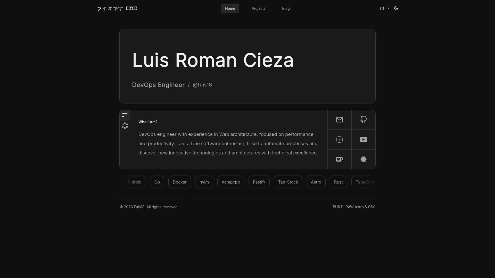

# My personal website

[](https://github.com/fuis18/fuis18.github.io/actions/workflows/ci.yml)


Built with Astro for performance, keeping dependencies minimal while still looking fascinating.

**Live demo:** https://fuis18.is-a.dev · [Español](README.es.md)

[](https://fuis18.is-a.dev)

## Features

- 4-language i18n (en, es, ja, de) with Paraglide, persisted across pages
- Light/dark mode and an interactive graph mode powered by vis-network
- Blog with tags and reading time localized per language
- Fully static (SSG), deployed on GitHub Pages

## Stack

- [Astro 7](https://astro.build) + TypeScript
- [Paraglide JS](https://www.npmjs.com/package/@inlang/paraglide-js) for i18n
- [vis-network](https://vis-network.js.org) for the graph view
- [Vitest](https://vitest.dev) + [Playwright](https://playwright.dev) for testing
- [Prettier](https://prettier.io) for formatting

## Commands

```sh
pnpm dev              # dev server
pnpm build && pnpm preview
pnpm test             # unit tests (Vitest)
pnpm test:e2e         # E2E (Playwright)
pnpm typecheck        # type checking (tsc --noEmit)
pnpm format           # formatting (Prettier)
pnpm paraglide        # compile i18n messages
```

## History

I started with [All-Projects](https://fuis18.github.io/All-Projects) in plain JS; adding dark mode led me to a palette I really liked.

Then, while learning React, I rebuilt it—though I left it unfinished ([commit](https://github.com/fuis18/fuis18.github.io/tree/53beb8944b794f0cea5b3e7ead396b7e2afcf6ec))—because I shifted my focus to studying Astro and setting up my Linux environment; thanks to that, I’m now able to offer something better.

Getting more involved from there, I ended up building a site that reflects me better as an engineer and as a person.

## Inspiration

- Main inspiration: [@raexera](https://github.com/raexera)
- Secondary inspiration: [@notkimu](https://github.com/notKimu), [@Equs](https://github.com/corecommit), [@vaxry](https://github.com/vaxerski)
- Thanks to: [@oscarbeaumont](https://otbeaumont.me/), [@jaimepine](https://discover.me/jamie), [@mati](https://github.com/rosymati), [@caarclos](https://github.com/caarlos0)

## License

MIT · see [LICENSE](LICENSE)
